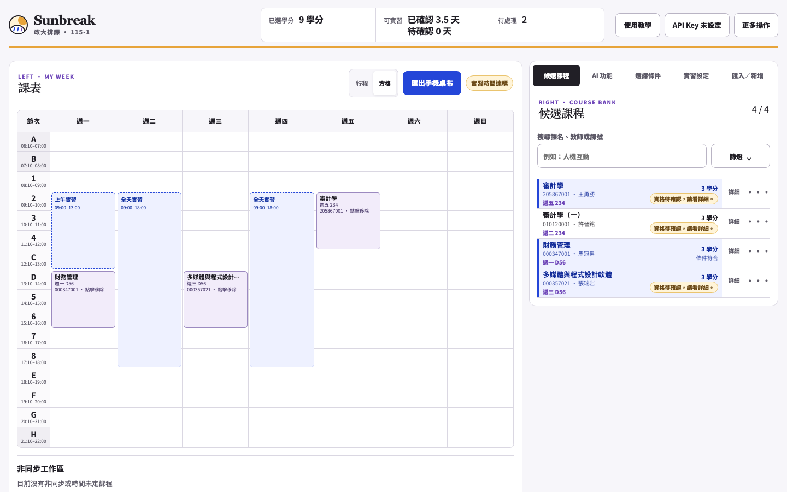

# NCCU Course Scheduler

**An internship-friendly course planner for National Chengchi University students: search the official course catalog, build a weekly timetable, and let AI suggest plans that local rules must approve before you see them.**

政大學生的實習友善排課工具。**非政大官方服務**，課程與選課規則仍以政大正式選課系統為準。

> **Type** Personal project · **Status** Completed (2026-07 → 2026-10), succeeded by [Campusward](https://github.com/Hunter20041004/campusward-nccu) · **Role** Solo project · **Stack** JavaScript (no npm dependencies), Cloudflare Worker-compatible server, Gemini (bring your own key)



## Background

Built for NCCU students who also hold internships and need to keep certain weekdays free while choosing courses. This was my first course planner. Its lessons now continue in [Campusward](https://github.com/Hunter20041004/campusward-nccu), a rebuilt version.

## What it does

- **Searches the official NCCU 115-1 catalog** by course name, teacher or nine-digit course code, with no API key.
- **Builds a timetable on NCCU's own period grid** (A/B/1–8/C/D/E–H, Monday to Sunday) and flags time conflicts.
- **Plans around internships**: find free days automatically or block fixed internship hours, keeping "confirmed" and "to be confirmed" days apart.
- **Tracks eligibility rules** generated from official course restrictions, plus your own programme or prerequisite conditions.
- **AI helpers with your own Gemini key**: read a screenshot of your course list, and suggest up to three plans.
- **Exports a phone wallpaper** of your timetable, and lets you undo clears and deletions within 15 seconds.

## Key decisions

| Decision | Why |
| --- | --- |
| AI proposes, local rules decide | A deterministic validator rejects any AI plan with a time conflict, ineligible course, too few credits, a dropped locked course or a broken internship day, so made-up courses never reach the user. |
| Bring your own key, nothing kept on the server | The Gemini key lives only in the current tab's memory, and screenshots and prompts aren't stored. |
| A blank personal workspace for every visitor | Friends opening the link see their own empty plan, never the author's, and progress stays in their own browser. |
| No npm dependencies | The whole app builds into one Worker bundle that is easy to audit and deploy. |

## Results

- 229 commits; 364 automated tests (unit, rendered-HTML and safety) plus a live contract test against NCCU's public course search, with CI and full-history secret scanning.

## Run it locally

Requires Node.js 22.13 or newer.

```bash
git clone https://github.com/Hunter20041004/nccu-course-scheduler.git
cd nccu-course-scheduler
npm install
npm run dev
```

Course search, scheduling, conflict checks and wallpaper export work without a key; only AI screenshot import and AI suggestions need your own Gemini API key. Full checks: `npm run verify`. Architecture and design notes: [`docs/`](docs/).

## Course data corrections

If a course's time, attendance mode or exam note differs from official data, report it with the [course data correction form](.github/ISSUE_TEMPLATE/course_data_correction.yml), including the semester, the full nine-digit course code, a publicly reachable official syllabus or announcement, and the expected fix. See [CONTRIBUTING.md](CONTRIBUTING.md). Verified corrections are tied to one semester and one exact course code, so they never apply to other semesters or courses.

## Notes

Not an official NCCU service. Course data and model availability can change. AI suggestions are decision support and do not guarantee graduation requirements or department approval. The hosted demo has been taken offline; run it locally to try it.

## 中文摘要

給同時在實習的政大學生用的排課工具。新訪客會從完全空白的個人工作區開始，可直接用政大 115-1 課程庫搜尋課名、教師或九碼課號，排進政大節次方格課表、檢查衝堂與修課條件，並保留實習空檔。同一個網址、同一個瀏覽器會接續上次進度。AI 截圖匯入與推薦使用自己的 Gemini 金鑰，推薦方案一定要通過本地規則檢查才會顯示。這是 Campusward 的前一版；請以政大正式選課系統、系所公告與授課教師最新通知作為最終依據。

## License

Author-owned source code and documentation in this repository are licensed under the [MIT License](LICENSE). National Chengchi University course data, third-party model services, and user-supplied screenshots remain subject to their respective owners' terms.
